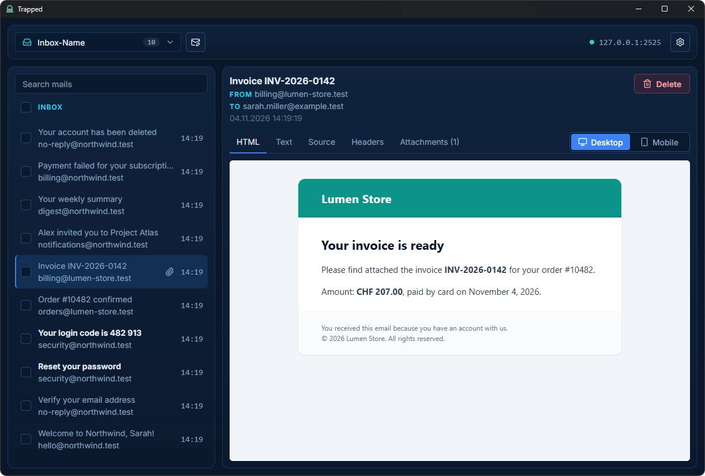

# Trapped

[](https://github.com/dragonofmercy/trapped/releases/latest)
[](https://github.com/dragonofmercy/trapped/releases)
[](LICENSE)
[](https://tauri.app/)
[](https://www.microsoft.com/windows)
[](https://ko-fi.com/dragonofmercy)

A local SMTP mail catcher for Windows, for developers who need to see what their app sends.



Trapped listens on `127.0.0.1:2525`, accepts every message, never relays anything, and shows what it caught like a webmail: the HTML rendering, the text version, the raw source, the headers and the attachments. Point your app's mail settings at it, send, and click the links in the mail (email verification, password reset, 2FA).

## Features

- **Catches everything** - any sender, any recipient, nothing ever leaves your machine.
- **Inboxes** - the SMTP username picks the inbox, so each project gets its own. An inbox is created on its first mail; mail sent without a username goes to `Inbox-Name`.
- **Mail view** - HTML (desktop or mobile width), text, source, headers and attachments. Tabs only show when the mail has that content. Inline images (`cid:`) are displayed.
- **Attachments** - open or save them. Executable files can only be saved.
- **Search and bulk delete** in the mail list, unread counts per inbox.
- **Configurable** - SMTP port, and listen address: `127.0.0.1` (this machine only) or `0.0.0.0` (other machines too, e.g. a shared Docker host).
- **Tray icon** - closing the window keeps Trapped running in the notification area.
- **Automatic updates** - when a new version is out, a banner offers to install it. Nothing is installed without your click, and no network means no banner.

## Laravel setup

```
MAIL_MAILER=smtp
MAIL_HOST=127.0.0.1
MAIL_PORT=2525
MAIL_USERNAME=Inbox-Name
MAIL_PASSWORD=null
MAIL_ENCRYPTION=null
```

`MAIL_USERNAME` is the inbox the mail lands in; any password is accepted. No TLS. When Trapped listens on `0.0.0.0`, use this machine's IP as `MAIL_HOST` on the other machines. The Options window shows this block with your current port, ready to copy.

## Where things are stored

- Mails and settings: `%APPDATA%\com.trapped.desktop\trapped.db`
- Opened attachments: `%LOCALAPPDATA%\com.trapped.desktop\attachments\` (emptied at each start)

## Requirements

- Windows 10 or 11
- Microsoft Edge WebView2 Runtime (already included in Windows 11 and up-to-date Windows 10)

## Building from source

Requires [Rust](https://rustup.rs) and [Node.js](https://nodejs.org).

```
.\build.ps1
```

It installs the npm dependencies if needed, then runs `npm run tauri build`. The MSI and NSIS installers are written to `src-tauri\target\release\bundle\`.

`build.ps1` signs the update files with the maintainer's key (`..\keys\updater.key`, not in the repo). Without it, build unsigned:

```
npm run tauri build -- --config '{\"bundle\":{\"createUpdaterArtifacts\":false}}'
```

For development: `npm install`, then `npm run tauri dev`.

## Releasing

1. List the changes under `## [Unreleased]` in `CHANGELOG.md`.
2. From `main` with a clean tree, run `.\release.ps1 1.0.0`.

It sets the version in `src-tauri\Cargo.toml` (the only place it lives), dates the changelog section, builds, commits, tags `v1.0.0`, pushes, and publishes the GitHub release with both installers and `latest.json`, the file the in-app updater reads.

## Support

If this project helps to increase your productivity, you can give me a cup of coffee :)

<a href="https://ko-fi.com/dragonofmercy"></a>

## License

MIT
